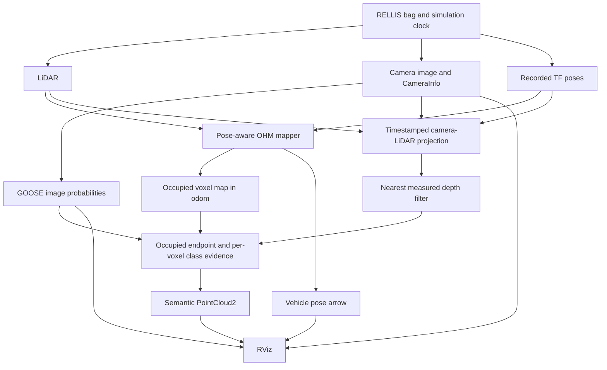

# Commands, code, outputs and remaining improvements

Prepared on 27 October 2026 from the current source and saved verification results.
This document explains the existing implementation. Creating this guide does
not change the mapping or model code.

## 1. What exists now

The application combines a pose-aware LiDAR occupancy map with camera class
predictions. It is a working semantic-mapping baseline. Classification coverage,
recognition accuracy, complete visibility handling, and traversability still
need development or evaluation.

| Component | Source and role |
| --- | --- |
| RELLIS-3D recording | Supplies the demonstrated LiDAR, camera images, calibration and recorded TF poses. |
| OHM | Accumulates occupancy evidence from transformed LiDAR rays. |
| GOOSE pretrained model | Supplies image segmentation predictions; an existing checkpoint is used without training a new model. |
| TartanDrive sample | A second recording used for a short occupancy/camera compatibility check. |
| ORAD-3D | Assessed as another dataset option; it is not connected to the demonstrated pipeline. |

The code runs locally in Ubuntu/WSL. It does not need this chat to be open.
The model weights are already on disk.



## 2. Terminal commands

Use Ubuntu/WSL terminals. Stop another copy of this mapper before starting a
new one. Run the same ROS domain settings in all terminals that must communicate.

### Terminal 1: run processing and RViz

```bash
source /opt/ros/humble/setup.bash
source ~/semantic_map_ws/install/setup.bash
export ROS_DOMAIN_ID=101
export ROS_LOCALHOST_ONLY=1
ros2 launch semantic_mapping semantic_integration.launch.py
```

Leave it running and wait for `Ready` from `camera_semantic_voxel`.

| Command | Why it is needed |
| --- | --- |
| `source /opt/ros/humble/setup.bash` | Makes the installed ROS 2 commands and packages available in this shell. |
| `source ~/semantic_map_ws/install/setup.bash` | Adds your built workspace, including `semantic_mapping`. |
| `ROS_DOMAIN_ID=101` | Places these ROS processes in the same discovery domain. The number is an isolation choice, not a coordinate frame. |
| `ROS_LOCALHOST_ONLY=1` | Keeps ROS communication local to this machine. |
| `ros2 launch ...` | Starts the C++ occupancy mapper, camera preview, semantic node and RViz together. |

All processing nodes launched here use simulation time.

### Terminal 2: supply the recorded data

```bash
source /opt/ros/humble/setup.bash
source ~/semantic_map_ws/install/setup.bash
export ROS_DOMAIN_ID=101
export ROS_LOCALHOST_ONLY=1
ros2 bag play ~/RELLIS-3D/example_filtered_ros2 \
  --clock --delay 3 --rate 0.25 --read-ahead-queue-size 10 \
  --qos-profile-overrides-path ~/semantic_map_ws/artifacts/semantic_integration_2026_10_26/playback_qos.yaml \
  --topics /tf /tf_static /os1_cloud_node/points \
    /pylon_camera_node/image_raw /pylon_camera_node/camera_info
```

| Argument | Meaning |
| --- | --- |
| `--clock` | Publishes recorded ROS time on `/clock`, matching the data timestamps. |
| `--delay 3` | Gives subscribers time to connect before replay begins. |
| `--rate 0.25` | Plays at quarter speed so CPU processing has more time. |
| `--read-ahead-queue-size 10` | Limits buffered messages to reduce playback memory use. |
| QoS override file | Selects compatible reliability/durability for the cloud and static transforms. |
| `/tf` | Recorded moving transforms, including vehicle pose. |
| `/tf_static` | Fixed sensor mounting relationships. |
| LiDAR topic | Measured 3D points. |
| Image topic | Recorded camera pixels. |
| CameraInfo topic | Camera intrinsics, distortion parameters, dimensions and frame identity. |

The bag contains about one minute of data, so quarter-speed playback takes
about four minutes. A timestamp around 1581791xxx is recorded dataset time,
not the current date on your PC. Images and the map stop changing at the end
of the recording; the processing nodes can remain open.

### Terminal 3: inspect operation

Start with:

```bash
source /opt/ros/humble/setup.bash
source ~/semantic_map_ws/install/setup.bash
export ROS_DOMAIN_ID=101
export ROS_LOCALHOST_ONLY=1
ros2 node list
```

During playback, the list should include the following main nodes, with
possible additional ROS helper nodes:

```text
/ohm_occupancy_pose_node
/camera_color_preview
/camera_semantic_voxel
/rviz2
/rosbag2_player
```

Inspect processing status:

```bash
ros2 topic echo /camera_semantic_voxel/status --once --qos-durability transient_local
```

Repeat after a few seconds. `paired`, `projected` and `fused_frames` should
increase while data is arriving. Their exact rates depend on CPU load.

Inspect the colored map header without printing its binary payload:

```bash
ros2 topic echo /semantic_voxel_map --field header --once --qos-durability transient_local
```

Expected: `frame_id: odom` and a recorded acquisition timestamp.

Inspect the vehicle pose while the recording is playing:

```bash
ros2 topic echo /vehicle_pose --once
```

The position is in `odom`; the quaternion represents orientation. This topic
does not retain an old sample for a new subscriber after playback has finished,
so the command can wait if no new pose messages are being published.

Optional TF inspection during playback:

```bash
ros2 run tf2_ros tf2_echo odom base_link
```

Press Ctrl+C to stop this diagnostic. It does not stop the mapper in Terminal 1.

Check the simulation-time setting and visibility mode:

```bash
ros2 param get /ohm_occupancy_pose_node use_sim_time
ros2 param get /camera_semantic_voxel use_sim_time
ros2 param get /camera_semantic_voxel strict_voxel_occlusion
```

Expected settings: `true`, `true`, `false` for the default integrated launch.

### Stop or replay

1. Press Ctrl+C in Terminal 2 if the player is still running.
2. Press Ctrl+C in Terminal 1 to stop mapping, processing and RViz.
3. To replay, restart Terminal 1, wait for Ready, then restart Terminal 2.

Do not use `--loop` for this workflow. The semantic node has some backwards-time
protection, but that does not reset the C++ occupancy map. A full restart is
still required for a fresh map.

### Build and test after code edits

The package is already built. After stopping the preview, use:

```bash
cd ~/semantic_map_ws
source /opt/ros/humble/setup.bash
source install/setup.bash
colcon build --packages-select semantic_mapping --symlink-install
source install/setup.bash
colcon test --packages-select semantic_mapping --return-code-on-test-failure
colcon test-result --test-result-base build/semantic_mapping/test_results --verbose
```

`build` compiles/installs the package. `test` exercises the implementation.
`test-result` prints the outcome. The verified result is 20 tests, 0 errors,
0 failures, 0 skipped. You do not need to rebuild before every bag playback.

### Automatic full recording check without a GUI

Run this separately from the interactive preview:

```bash
source /opt/ros/humble/setup.bash
source ~/semantic_map_ws/install/setup.bash
ROS_DOMAIN_ID=99 ROS_LOCALHOST_ONLY=1 python3 \
  ~/semantic_map_ws/src/semantic_mapping/tools/check_semantic_integration.py \
  --seconds 130 --rate 0.5 \
  --output ~/semantic_map_ws/artifacts/my_semantic_check
```

The tool starts and stops its own mapper and player. Read its report:

```bash
cat ~/semantic_map_ws/artifacts/my_semantic_check/report.json
```

Look for `passed: true` and `occupied_geometry_matched: true`. It also saves
camera, segmentation, projection and map images, structured voxel data and poses.
Reusing an output directory replaces that check's files; choose another name
when preserving a comparison.

### Previous green occupied-map view

Stop the integrated launch and player first. In Terminal 1, with the same ROS
setup and exports, run:

```bash
ros2 launch semantic_mapping mapping_reference.launch.py dataset:=rellis
```

Run Terminal 2's playback command again. This uses the existing pose-aware
mapper and camera/projection reference nodes. No source restoration is needed.

### Optional strict voxel-ray comparison

Stop the running launch and player before switching modes:

```bash
ros2 launch semantic_mapping semantic_integration.launch.py strict_voxel_occlusion:=true
```

Then replay using Terminal 2. The strict mode may classify far fewer voxels
because it treats occupied cubes as solid occluders. For an automatic comparison,
add `--strict-voxel-occlusion` to the automatic check command and use a new output
directory. Do not run two launch variants in the same domain at the same time.

## 3. Source folders and preservation

Handwritten package files are under:

```text
~/semantic_map_ws/src/semantic_mapping/
```

`build/`, `install/` and `log/` are build/run outputs. Make source changes under
`src/`; rebuilding updates installed executables, Python modules and configurations.

During the semantic integration stage, only `CMakeLists.txt` changed among the
previously existing package files. Two lines were added: installation of the new
semantic script and registration of its tests. Runtime additions were separate
files. Earlier pose/camera stages also added their own files and dependencies;
those stages have separate backups.

Verified pre-integration copies of all 25 previous package files are in:

```text
~/semantic_map_ws/src/semantic_mapping/backups/before_semantic_integration/previous_files/
```

A ZIP contains the same snapshot:

```text
~/semantic_map_ws/src/semantic_mapping/backups/before_semantic_integration/semantic_mapping_before_integration.zip
```

List the ZIP contents using Python's standard library:

```bash
python3 -m zipfile -l ~/semantic_map_ws/src/semantic_mapping/backups/before_semantic_integration/semantic_mapping_before_integration.zip
```

The copies were verified against hashes saved before integration. CMakeLists.txt
and package.xml also have separate `.original` copies. Earlier snapshots remain
under `backups/before_pose_mapping/` and `backups/before_camera_projection/`.
The backup is package source, not a copy of the complete dataset/workspace.

## 4. C++ occupancy mapper

File: `src/ohm_occupancy_pose_node.cpp`. This is the pose-aware variant created
earlier. It remains unchanged during the semantic integration stage.

| Function or operation | How it works and why |
| --- | --- |
| Constructor | Creates OHM, the TF buffer/listener, the cloud subscriber, and map/pose publishers. Parameters default to 0.35 m resolution, 10 m range, world frame `odom`, vehicle frame `base_link`. |
| `cloudCallback()` timestamp check | Rejects zero timestamps and empty frames. Time zero in TF means latest; that would use the wrong pose for historical scans. |
| `lookupTransform()` | Gets `odom <- sensor` at the cloud timestamp. Missing TF causes the scan to be skipped instead of integrated at a guessed pose. |
| Dedicated TF listener thread | Allows transforms to arrive while the callback waits briefly for them. |
| PointCloud2 iterators | Read X/Y/Z directly from the binary cloud, respecting named field offsets. |
| Finite/range filtering | Removes NaN/infinite points and points outside 0.1–10 m in sensor coordinates. |
| World transformation | Applies the recorded sensor rotation and translation to each endpoint. This incorporates vehicle pose and mounting offset. |
| Moving ray origin | Uses the sensor's world position for the start of every ray. Rays must move with the sensor when clearing free space. |
| `integrateRays()` | Passes alternating origin/endpoint vectors to OHM. The size argument is the number of vectors, twice the number of rays. OHM updates occupancy evidence. |
| Vehicle pose publication | Looks up `odom <- base_link` at the scan time and publishes `/vehicle_pose`. The base pose differs from the mounted LiDAR pose. |
| `ohm::isOccupied()` | Selects observed occupied cells. OHM's unobserved values can be positive infinity, so a plain `> 0` test can incorrectly render them. |
| `voxelCentreGlobal()` | Gives the correct world coordinates for each occupied cube center. |
| Single `CUBE_LIST` marker | Publishes all occupied cubes together, avoiding one separate marker object per voxel. |
| `main()` | Initializes ROS, spins the node so callbacks run, and shuts ROS down. |

The basic geometric relationship is:

```text
p_world = R_world_sensor × p_sensor + t_world_sensor
```

OHM still updates free space internally. Only occupied cells are visualized.
Ground and grass surfaces can be occupied; occupancy alone does not establish
whether the vehicle can drive over them.

## 5. Camera color reference

File: `scripts/camera_color_preview.py`.

| Function | How and why |
| --- | --- |
| `CameraColorPreview.__init__()` | Creates a subscriber to the raw camera and a publisher for `/pylon_camera_node/image_color`. Uses sensor-compatible input QoS. |
| `on_image()` | Uses CvBridge to convert the recorded Bayer image to `bgr8`, an ordinary color image RViz can display. Preserves the original header/time/frame so conversion does not change acquisition identity. |
| Conversion error handler | Reports unsupported/bad image data and skips it instead of publishing an invalid reference. |
| First-frame log | Confirms the real image dimensions and conversion once, avoiding repeated console messages. |
| `main()` | Runs the ROS event loop and handles shutdown. |

This node produces camera appearance only. Terrain labels come from the model.

## 6. Projection helper

File: `semantic_mapping/camera_projection.py`. Both reference projection and
semantic integration use this geometry code.

| Function/data object | How and why |
| --- | --- |
| `Projection` | Stores original point indices, projected pixels, camera depths and sampled RGB. Keeping indices preserves correspondence to the original LiDAR points. |
| `transform_matrix()` | Validates/normalizes the TF quaternion and forms a 4×4 rotation/translation matrix. Rejects invalid values. |
| `transform_points()` | Applies one transform to an entire N×3 NumPy array using matrix arithmetic. |
| `xyz_from_cloud()` | Reads named XYZ fields from a structured PointCloud2 array. Ouster also has integer metadata; this avoids the mixed-datatype failure encountered with `read_points_numpy()`. |
| `project_visible_points()` | Filters invalid/range-limited points; transforms them into camera coordinates; removes points behind the camera; projects with OpenCV using K/D distortion; removes out-of-image samples; retains nearest measured depths in small pixel cells. |
| `draw_projection()` | Draws depth-colored dots on the camera image for alignment inspection. Dot color represents depth, not semantic class. |

For the semantic node, the visibility cell is 4×4 raw-image pixels and depth
tolerance is zero. The reference-only projector uses its own defaults (2 pixels,
0.10 m tolerance). This distinction matters when comparing their overlays.

The transform between different acquisition times is:

```text
T_camera_lidar = inverse(T_world_camera at image time)
                 × T_world_lidar at scan time
```

The code computes this with `np.linalg.solve()`. Projecting to pixels then uses
the camera intrinsics and lens distortion. Without distortion, the familiar
relationship is `u = fx*X/Z + cx`, `v = fy*Y/Z + cy`.

This corrects the camera/scan timestamp difference for a static scene. It does
not deskew individual LiDAR returns or compensate independently moving objects.

## 7. Reference-only projection node

File: `scripts/camera_lidar_projection_node.py`. It was added before semantic
integration and remains available through `mapping_reference.launch.py`.

| Function | How and why |
| --- | --- |
| `stamp_ns()` | Converts a ROS timestamp to integer nanoseconds for comparison/reporting. |
| `CameraFrame.header` | Lets the synchronizer treat a paired image/calibration object as timestamped data. |
| `rgb_cloud()` | Packs projected XYZ and sampled camera RGB into a standard PCL-compatible cloud. |
| Constructor | Sets up exact image/CameraInfo pairing, approximate camera/LiDAR pairing, TF, bounded pending work, and output/status publishers. |
| `count()` | Updates diagnostic counters. |
| `on_camera()` | Checks that calibration frame, dimensions and focal lengths match the image. |
| `on_pair()` | Queues timestamped camera/LiDAR pairs and rejects empty identities. |
| `process_pending()` | Waits a bounded wall time for acquisition-time TF; it does not block TF reception indefinitely. |
| `project_pair()` | Converts pixels, reads XYZ, applies projection, publishes the alignment overlay and an RGB surface cloud in the fixed world frame. |
| `publish_status()` | Makes synchronization/output state visible from the terminal. |
| `main()` | Runs and cleans up the node. |

Its RGB cloud is camera-colored geometry. It is not the class-colored semantic
map. The integrated semantic node performs its own projection using the shared
helper and does not launch this reference-only node in parallel by default.

## 8. Segmentation model adapter

File: `semantic_mapping/goose_model.py`.

This is an inference-only adaptation of the existing SuperGradients PP-LiteSeg-B
architecture. The checkpoint was downloaded from GOOSE. It is not a newly
designed or newly trained neural network. Training/framework dependencies were
removed while retaining the parameter names and forward calculations.

| Class/function | Role and reason |
| --- | --- |
| `ConvBNReLU` | Basic convolution, batch-normalization and activation block. Its parameter names match the checkpoint. `forward()` applies the sequence. |
| `STDCBlock` | Combines feature channels produced at successive convolution steps; downsampling blocks reduce spatial resolution. |
| `Backbone` | Extracts image features at multiple scales, returning the 1/8, 1/16 and 1/32-resolution stages. |
| `SPPM` | Pools context at several spatial sizes, upsamples and combines it so predictions use more than a local patch. |
| `Encoder` | Combines backbone features, context and channel projections for decoding. |
| `UAFM` | Uses learned attention to combine coarse features with finer skip features. Mean/max channel summaries drive the attention. |
| `Decoder` | Applies successive fusion/upsampling stages to restore spatial detail. |
| `SegmentationHead` | Converts feature channels into one score per original class. |
| `PPLiteSegB` | Connects encoder, decoder and head, returning 64 score maps. |
| `GoosePredictor.__init__()` | Limits CPU threads, creates the model in evaluation mode, loads the checkpoint on CPU, and strictly verifies every expected weight. |
| `GoosePredictor.predict()` | Converts BGR to RGB; scales values to [0,1]; resizes to 512×512; performs inference without training gradients; applies softmax; sums the original 64 class probabilities into six groups. |

`eval()` disables training behavior such as dropout and batch-statistic updates.
`torch.inference_mode()` avoids creating training gradient state. Strict loading
prevents inference with accidentally missing/random weights. RGB order and
preprocessing must match the published GOOSE example.

All 421 checkpoint tensors loaded strictly. A comparison against the original
upstream forward classes produced maximum absolute logit error 0 on the tested
input. That establishes adapter consistency, not recognition accuracy.

The checkpoint, its checksum, upstream source hashes and preprocessing details
are under `~/semantic_map_ws/models/goose/`. Attribution and the source license
are in `THIRD_PARTY_NOTICES.md` and `LICENSE.super-gradients`.

## 9. Semantic evidence helper

File: `semantic_mapping/semantic_fusion.py`.

| Function/object | How and why |
| --- | --- |
| `CLASS_NAMES`, `PALETTE` | Define six output IDs and display colors. They do not infer classes. |
| `voxel_keys()` | Computes integer spatial addresses with `floor(point/resolution)`. Floor is essential for negative coordinates. |
| `first_occupied()` | Traverses a camera-to-endpoint segment through grid cells and stops at the first occupied cube. Used by optional strict visibility. Handles negative directions and tied boundary crossings. |
| `surface_observations()` | Requires normalized finite probabilities and an occupied measured endpoint. Optionally checks strict ray visibility. Averages multiple accepted returns in one voxel into a single distribution for that image. |
| `Evidence` | Stores class counts, number of timestamped image observations, and the last image timestamp. |
| `SemanticEvidence.__init__()` | Initializes the minimum observation/confidence requirements and a small prior for each class. |
| `retain_occupied()` | Removes evidence when a voxel is no longer occupied, preventing stale labels from appearing on cleared geometry. |
| `update()` | Adds at most one distribution per voxel per image timestamp. Rejects duplicate/older timestamps. Caps accumulated evidence magnitude to limit long-term inertia. |
| `query()` | Converts accumulated counts into normalized class estimates. Returns a class only when both observation and confidence requirements are met; otherwise returns unknown. |

The simplified update is:

```text
Start:     alpha[class] = 0.05
Per image: alpha[class] += mean predicted class probability in that voxel
Estimate:  posterior[class] = alpha[class] / sum(alpha)
```

The extra evidence is rescaled if its total exceeds 100. The reported observation
count still records the number of accepted distinct image timestamps. Different
timestamps do not imply statistical independence: adjacent frames can be strongly
correlated, which remains an uncertainty-modeling issue.

A hundred LiDAR samples in one voxel during one image count as one image
observation. This avoids dense vegetation receiving artificial confidence just
because it generated many returns.

The helper's strict-ray argument defaults to true when used by itself. The
running integrated node explicitly supplies the launch parameter, which defaults
to false. The launch setting determines actual runtime behavior.

## 10. Main semantic integration node

File: `scripts/camera_semantic_voxel_node.py`.

| Function/object | How and why |
| --- | --- |
| `ns()` | Produces integer nanosecond timestamps, avoiding floating-point equality errors in map matching. |
| `CameraFrame` | Keeps an image and matching CameraInfo together. Its `header` exposes image time to message filters. |
| `MapFrame` | Keeps an occupied marker, NumPy centers, integer keys and an immutable occupied-key set together. |
| `semantic_cloud()` | Packs current occupied centers, RGB, label, confidence and observation count into one PointCloud2. It preserves geometry/frame identity and gives RViz a standard packed RGB field. |
| Constructor | Validates parameters, loads class mapping and model, sets up subscribers/synchronizers, creates TF and evidence state, a worker, bounded queues, publishers and timers. |
| `on_camera()` | Rejects mismatched dimensions/frames, invalid focal lengths and unsupported raw-image distortion models. Invalid calibration must not silently label voxels. |
| `on_pair()` | Records approximate camera/LiDAR matches. Rejects missing frames/zero times and counts bounded-queue discards. |
| `on_map()` | Accepts occupied CUBE_LIST input only in the expected frame, resolution and grid origin. Caches up to 32 timestamped maps, prunes evidence for cleared cells, and republishes current geometry. |
| `tick()` | Collects finished inference work; selects a recent valid pair; waits for its exact LiDAR-time occupied map and acquisition-time TF; submits one worker job. |
| `process()` | Converts the raw image, projects/filters points, predicts class probabilities, samples them at projected pixels, transforms endpoints to world coordinates, forms occupied-voxel observations and creates output images. |
| `finish()` | Applies completed observations only to voxels still occupied in the current map; publishes images, updates counters and republishes the colored map. |
| `publish_map()` | Queries accumulated labels for the current occupied keys, publishes PointCloud2 and updates class counts. |
| `publish_status()` | Publishes counters, last timestamps, timing, pending work, model identity and visibility mode as JSON. |
| `close()` | Waits for/cancels worker work as appropriate and destroys ROS resources. |
| `main()` | Initializes ROS and runs its callback loop with clean shutdown. |

The concurrency and timing choices are deliberate:

- Exact image/CameraInfo synchronization avoids using another image's calibration.
- Approximate camera/LiDAR synchronization allows up to 50 ms difference.
- Camera and LiDAR poses are looked up at their own acquisition times.
- The occupied map must have exactly the paired LiDAR timestamp.
- A single inference worker keeps ROS callbacks able to receive TF and new data.
- The pending deque holds at most eight pairs; older work can be discarded.
- A 32-map cache bounds retained map snapshots.
- A steady-clock timer can still handle timeouts when bag time is paused.
- Older worker results are discarded after a detected backwards map-time change.
- Current occupied membership is checked again before applying a delayed result.

These choices favor bounded work and timely observations. They do not guarantee
processing of every scan. CPU backlog and message drops remain important limits.

The semantic state currently lives alongside OHM, keyed by the same voxel grid.
It has not been added as a serialized native OHM semantic layer. Stopping the
node loses its in-memory evidence unless outputs were saved separately.

## 11. Launch, configuration and build files

| File | Construction and purpose |
| --- | --- |
| `launch/semantic_integration.launch.py` | `generate_launch_description()` declares model path, confidence/count thresholds, RViz toggle and strict visibility. Starts the existing C++ mapper plus camera preview, semantic node and RViz with simulation time. |
| `launch/mapping_reference.launch.py` | `start_nodes()` selects RELLIS or Tartan topics/frames and the corresponding reference RViz configuration. `generate_launch_description()` exposes dataset and RViz options. |
| `config/semantic_integration.rviz` | Configures `odom`, a view following `base_link`, semantic boxes of size 0.35 m, the pose arrow and image panels. It controls display, not inference. |
| `config/goose_classes.json` | Explicitly maps every original class ID to a displayed group. For example, tree_trunk=28 and water=54. Separate IDs avoid guessing class meaning from RGB. |
| Playback QoS YAML | Selects best-effort clouds and retained reliable static TF so subscriptions can receive the recording correctly. |
| `CMakeLists.txt` | Builds both C++ variants, installs Python scripts/configurations and registers pytest targets. This integration added the semantic-script install line and semantic-test line. |
| `package.xml` | Declares ROS/Python runtime and build dependencies. Camera dependencies were added in the earlier projection stage; this file was unchanged during semantic integration. |
| `requirements-semantic.txt` | Records the PyTorch requirement separately. PyTorch was already installed on this PC. |
| Documentation/license files | Record operation, provenance, attribution and preservation. They do not change runtime algorithms. |

The launch currently relies on matching default frame/resolution/range settings
between the two mapping nodes. Changing only one node can trigger map validation
failures. Exposing shared settings from one configuration is a future improvement.

## 12. Tests and verification scripts

| File | What is checked |
| --- | --- |
| `test/test_ohm_pose_mapping.py` | Four ROS tests using synthetic timestamped TF/clouds: world alignment, occupied-only display, missing-pose rejection/interpolation, free-space clearing and moving ray origins. |
| `test/test_camera_projection.py` | Five tests: RGB sampling and near/far visibility, camera/scan-time transforms, lens distortion, invalid/empty inputs and mixed PointCloud2 field types. |
| `test/test_semantic_fusion.py` | Eleven cases including parameterized ray directions: first occupied surface, occluded endpoints, repeated/dense observations, conflicting evidence, clearing, negative grid keys, official IDs and measured-depth rejection. |
| `tools/check_recording.py` | Starts a mapper/player without RViz, receives occupied geometry/pose/camera outputs, and saves counts/images/plots. Used for RELLIS projection and Tartan compatibility. |
| `tools/check_semantic_integration.py` | Starts the integrated launch without RViz and a player; records outputs; checks current geometry against the original OHM map at the same stamp; checks count/confidence thresholds; saves results and stops its own processes. |

The recording tools use `main()` for argument parsing/lifecycle and receive
callbacks to collect messages. The integrated tool's `stamp_ns()` indexes map
snapshots without timestamp rounding; its `receive()` records counts, a small
geometry cache and vehicle poses. Process cleanup is in `finally` so its test
processes do not intentionally remain after the check.

The ROS test harness creates private topic names, publishes controlled transforms
and clouds, waits for outcomes and cleans up its node/process. Those tests
establish algorithm behavior under known inputs. They do not provide semantic
accuracy scores for the actual terrain.

## 13. What each output means

### ROS topics

| Topic | Type and meaning |
| --- | --- |
| `/semantic_voxel_map_cpp` | Marker CUBE_LIST: occupied OHM geometry, green in the reference view. |
| `/semantic_voxel_map` | PointCloud2: the same current occupied centers with accumulated semantic attributes. |
| `/vehicle_pose` | PoseStamped: vehicle position/orientation in `odom` at an integrated scan time. |
| `/pylon_camera_node/image_color` | Color image for visual reference. |
| `/camera_semantic_voxel/segmentation_image` | Camera image blended with current per-image class predictions and legend. It is not accumulated voxel evidence. |
| `/camera_semantic_voxel/labels` | Single-channel image whose values are grouped IDs 0–5, not RGB colors. |
| `/camera_semantic_voxel/projection_image` | Camera image with LiDAR depth-colored points for alignment inspection. |
| `/camera_semantic_voxel/status` | JSON diagnostic counters and last-frame information. |

The reference-only projector instead publishes `/camera_lidar_projection/*`.
Its `/points_rgb` cloud has sampled camera appearance, not semantic class labels.

### Voxel fields

| Field | Meaning |
| --- | --- |
| `x`, `y`, `z` | Occupied cube center in `odom`, in metres. Z is world height, not height above local ground. |
| `rgb` | Packed display color corresponding to the accepted class ID. |
| `label` | 0 unknown, 1 ground, 2 vegetation, 3 trunk, 4 water, 5 obstacle. |
| `confidence` | Maximum accumulated class estimate. It is not calibrated safety confidence. It can be high while label=0 because the minimum observation count was not reached. |
| `observations` | Accepted different-image-timestamp observations for that currently occupied voxel. |

The packed cloud uses 28 bytes per point with explicit offsets. RGB bits are
advertised in a FLOAT32 field for the standard PCL/RViz convention; the bits
encode color and should not be interpreted as an ordinary float intensity.

### Colors and screen interpretation

| Display | Interpretation |
| --- | --- |
| Gray cubes | Occupied geometry with an unknown/unaccepted terrain class. They are not rendered free-space cells. |
| Brown cubes | Ground prediction. Ground includes several surface types and is not automatically safe. |
| Green cubes | Vegetation prediction. Grass and tree crowns share this group, so green is not a drive permission. |
| Dark brown cubes | Trunk/root prediction. |
| Blue cubes | Water prediction, when observations support that class. |
| Red cubes | Obstacle group, which includes several original object/structure/vehicle/person classes. |
| Red arrow | Vehicle position and heading, separate from red obstacle cubes. |
| Camera reference panel | Recorded image used to compare perception with the real scene. |
| Prediction panel | Current camera model output; may change while accumulated voxel labels remain conservative. |
| Projection panel | Calibration/timing reference; dot colors represent depth, not the terrain palette. |

RViz may follow `base_link` while its Fixed Frame remains `odom`. A following
camera view does not mean the map itself is integrated in the moving frame.

### Diagnostic fields

| Field | Exact interpretation |
| --- | --- |
| `paired` | Camera/calibration frames matched approximately with a LiDAR scan. |
| `projected` | Completed processing jobs that reached publication. |
| `fused_frames` | Jobs that updated evidence in at least one still-occupied voxel; this includes uncertain class evidence. |
| `dropped` | Discarded pairs from several causes, including stale/repeated work, bounded queues, unavailable map/TF, invalid inputs or errors. The current counter does not separate these causes. |
| `occupied_voxels` | Number of geometry cells in the current displayed occupied map. |
| `class_counts` | Current accepted labels, including unknown. |
| `voxels_with_evidence` | Currently occupied voxels with stored class evidence, including those not yet accepted as a class. |
| `processing_seconds` | Time in the last worker `process()` call, including conversion/projection/model/aggregation/overlay work. It excludes queue waiting and is not end-to-end latency. |
| `updated_voxels` | Number of current occupied voxels updated by the last completed image. |
| `visibility.samples` | Returns remaining after projection and nearest-depth filtering, before occupied membership/strict-grid tests. |
| `visibility.missing_surface` | Candidate endpoints absent from the paired occupied map. This reports disagreement, not its cause. |
| `visibility.occluded` | Rejections from optional strict cube traversal. It stays zero when that check is disabled. It does not count nearer-depth filtering and does not prove no occlusions exist. |
| `visibility.visible_voxels` | Unique endpoint voxels with accepted observations in that processed image. |
| `image_minus_lidar_ms` | Camera timestamp minus LiDAR timestamp; a negative value means the image was captured first. |
| `pending` | Pairs still waiting to be processed or to obtain the required geometry/TF. |
| `inference_busy` | Whether a worker future remains outstanding. |
| `visibility_mode` | `measured_lidar_depth` by default; `solid_voxel_rays` for the optional stricter comparison. |

## 14. Measured result and its limits

Saved report:

```text
~/semantic_map_ws/artifacts/semantic_integration_2026_10_26/depth_constrained_replay/report.json
```

| Measurement | Result |
| --- | --- |
| Replay rate / wall test duration | 0.5 / 130 seconds |
| Recorded pose span / vehicle displacement | 59.0 seconds / 55.29 m |
| Occupied map and pose messages received | 233 each |
| Paired frames / fused frames / discarded pairs | 372 / 107 / 265 |
| Final occupied voxels | 33,511 |
| Final accepted classes | 308 vegetation, 1 ground, 6 obstacle |
| Unknown | 33,196 |
| Final classified total | 315, approximately 0.94% of occupied voxels |
| Voxels with stored evidence | 1,336 |
| Maximum accepted-image count in a current voxel | 31 |
| Last worker processing time | 0.488 seconds |
| Last image minus LiDAR time | −23.98 ms |
| Geometry comparison | Passed against the OHM marker at the same timestamp |
| Automated tests | 20 passed |

About 71% of paired frames were discarded in this run. That number combines
several causes; it is not a measured CPU-only drop rate. The 0.488-second value
is one final sample, not an average or a real-time guarantee. Exact output
counts can vary with scheduling and DDS delivery.

315 classified voxels does not mean 315 verified correct voxels. There is no
matching ground-truth semantic accuracy result yet. Zero accepted water/trunk
voxels does not establish that the classes are reliably recognized or absent.

The measured-depth filter retains only the nearest sampled return in each
small pixel cell. Sparse LiDAR cannot guarantee camera visibility between
samples or for unseen foreground objects. Complete semantic ray tracing and
occlusion accuracy remain open evaluation/development tasks.

The stricter cube test was compared over the moving sequence and ended with
14 classified voxels. Coarse 0.35 m cubes can intersect grazing ground rays
before their actual surfaces. Its final-frame diagnostic found 2,354 blocked
returns and a median depth difference of 1.43 m. This explains the choice to
use measured depths by default; it does not establish that every rejected ray
in the strict mode was a false rejection.

The second-dataset Tartan check produced 1,506 occupied voxels, but its 1.5-second
segment was nearly stationary. Treat that as compatibility evidence, not a
second-environment mapping accuracy evaluation.

## 15. Improvements in priority order

These are proposed next steps, not changes silently applied by this document.

1. **Measure why coverage is low.** Add separate counters for queue overflow,
   stale time, missing TF, missing exact map, free endpoint, low confidence,
   too few observations and clearing. Measure how much retained evidence is
   lost when occupied cells change state. This distinguishes perception problems
   from geometry/timing problems before tuning thresholds.
2. **Validate image/LiDAR alignment and semantics.** Inspect hard boundaries in
   several frames and through vehicle motion; measure reprojection error using
   appropriate correspondences. Use annotations for the same recording/frame
   or manually label representative frames. Measure class IoU/precision/recall
   and water/trunk errors. A mask from another sequence cannot validate this bag.
3. **Reduce dropped work with profiling.** Measure inference, cloud decoding,
   map conversion, visibility, publishing and queue latency separately. Consider
   grouping occupied candidates earlier, reducing repeated full-map work,
   vectorizing aggregation, or evaluating a faster model/available accelerator.
   Benchmark accuracy with every resolution/model change. Lowering thresholds
   just to increase colors would hide uncertainty rather than diagnose it.
4. **Improve visibility and uncertainty.** Evaluate sparse-depth completion or
   surface-aware visibility against actual occlusion cases. Compare measured
   depth and strict cubes. Incorporate pose/calibration uncertainty, boundaries,
   temporal correlation and class-confidence calibration. Report depth-filter
   rejections separately from cube-ray rejections.
5. **Improve persistence and reproducibility.** Evaluate evidence behavior when
   cells are briefly cleared/reoccupied; do not simply retain stale labels on
   genuinely free space. Add tested save/load of geometry and semantic state,
   shared launch parameters, reproducible model checksums and a complete replay
   reset. The current NPY report output is not a native OHM semantic save format.
6. **Compute heights and traversability.** Estimate a local ground surface,
   calculate obstacle height relative to that surface, slope, roughness and
   overhead clearance. A useful relationship is
   `height_above_ground = z_surface - z_ground(x,y)`. Combine this with classes
   and the measured POLARIS footprint/clearance limits. Vehicle-specific safe
   thresholds and water depth cannot be inferred from a class color alone.
7. **Evaluate a second environment properly.** Use a longer moving recording
   with its own LiDAR, images, calibration, timestamps and poses. Do not reuse
   RELLIS camera calibration for another platform. Compare coverage, consistency,
   accuracy and runtime under the same test protocol.

## 16. Brief explanation for a supervisor

The system now uses recorded poses to maintain an occupied OHM map in a fixed
world frame, associates pretrained camera class predictions with measured
occupied surfaces, accumulates voxel class evidence across images, and displays
the result together with the camera and vehicle pose. Geometry consistency was
checked through 55 m of vehicle motion and 20 software tests passed. The current
result establishes end-to-end integration; low semantic coverage, accuracy,
complete occlusion handling, heights and traversability remain to be evaluated
or developed.

Further files: `RUN_IT_YOURSELF.md` gives the short daily workflow;
`semantic_integration.md` records integration details; `verification_and_fusion.md`
records the earlier dataset/projection work.
