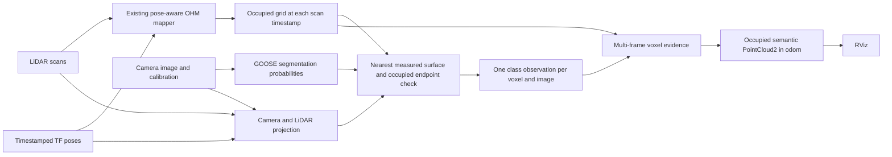

# Camera semantics integrated with the occupied OHM map

This separate launch connects the existing pose-aware C++ mapper to a camera
segmentation model and persistent per-voxel semantic evidence. The resulting
occupied map is published as `PointCloud2` on `/semantic_voxel_map` with class
colors. The previous green map remains on `/semantic_voxel_map_cpp`.

## Run it

Stop other mapper and playback terminals first. Use the same ROS_DOMAIN_ID in
every terminal. The new launch is already built in this workspace.

Terminal 1:

```bash
source /opt/ros/humble/setup.bash
source ~/semantic_map_ws/install/setup.bash
ros2 launch semantic_mapping semantic_integration.launch.py
```

Wait until the semantic node prints `Ready`, then start Terminal 2:

```bash
source /opt/ros/humble/setup.bash
ros2 bag play ~/RELLIS-3D/example_filtered_ros2 \
  --clock --delay 3 --rate 0.25 --read-ahead-queue-size 10 \
  --qos-profile-overrides-path ~/semantic_map_ws/artifacts/semantic_integration_2026_10_26/playback_qos.yaml \
  --topics /tf /tf_static /os1_cloud_node/points \
    /pylon_camera_node/image_raw /pylon_camera_node/camera_info
```

The limited playback queue reduces memory use. The slower replay gives CPU
inference time to process observations; it is not a claim of real-time mapping.
The bag lasts about 60 recorded seconds (about four minutes at this replay rate).
Restart the launch before restarting or seeking the bag backwards. Do not loop.

RViz loads `odom` as Fixed Frame, follows `base_link`, and contains:

- occupied semantic voxels on `/semantic_voxel_map`, rendered as 0.35 m boxes;
- the vehicle pose arrow;
- the original color camera image;
- a segmentation overlay with a class legend.

The projection-reference image is available as a disabled display. Enable it
to inspect image/LiDAR alignment. The YAML configuration and launch arguments
were checked; the new RViz arrangement still needs visual confirmation on the
desktop. Headless tests have received all its underlying topics.

Optional diagnostic Terminal 3:

```bash
source /opt/ros/humble/setup.bash
ros2 topic echo /camera_semantic_voxel/status --once
```

## How information reaches a voxel



Image and CameraInfo timestamps must match exactly. LiDAR is paired within
50 ms. The semantic node waits for the occupied map with the **same LiDAR
timestamp**, world-from-camera at the image timestamp, and world-from-LiDAR at
the scan timestamp. It never substitutes the latest pose.

LiDAR points within 10 m are projected using the recorded raw K/D calibration.
Points behind the camera or outside the image are excluded. The model predicts
the whole image, but only measured LiDAR endpoints can update the map.

For each camera ray sample, the closest measured LiDAR camera-depth in its
4×4 raw-image pixel cell is retained; farther returns in that cell are rejected
with zero depth tolerance. Only the retained return's occupied endpoint voxel
can receive a class observation. Free and unknown endpoint cells do not receive
semantic updates. No rays extend behind their measured endpoints, and no
image-only depth or filled space behind obstacles is invented.

This measured-depth rule avoids treating every coarse occupied cube as a solid
object. At grazing angles a 0.35 m ground voxel extends above the actual surface
and can intersect a camera ray metres before its measured return. A full moving
test with strict cube occlusion retained only 14 classified voxels out of
33,761 occupied voxels at the end. An offline check on its final frame found
2,354 returns blocked by coarse cubes, with a median depth difference of 1.43 m.
This motivated using the actual measured camera depths by default.

For a stricter comparison, run the new launch with
`strict_voxel_occlusion:=true`. That mode also traverses camera-to-return rays
and accepts an endpoint only when its cell is the first occupied cube. At exact
voxel corners, zero-volume touches are skipped. The traversal implementation and
its tests remain available; the default does not equate voxel volume with a
fully observed opaque surface.

Dense samples in one voxel are averaged into one observation per image.
Dirichlet pseudo-counts accumulate these distributions over independent images.
Repeated/older timestamps cannot inflate a voxel's count. A voxel becomes
colored after at least two observations and a maximum posterior of at least
0.6. Otherwise its label remains unknown. Evidence is removed when OHM clears
the occupied voxel. The colored output always uses the current occupied map's
geometry; semantic evidence is stored alongside OHM, not in a modified OHM layer.

## Model and colors

The checkpoint is the official GOOSE `ppliteseg_class_512.pth`, with 64 output
classes. It runs on CPU using the PyTorch already installed on this machine.
Preprocessing follows GOOSE's RGB ToTensor [0,1] example with a 512×512 resize;
it does not apply ImageNet normalization. A compact inference-only architecture
adapter avoids installing SuperGradients or changing ROS dependencies.

Every one of the 421 checkpoint tensors loaded strictly. A comparison against
the original upstream forward classes produced identical logits on a fixed
512×512 test input (maximum absolute error 0). This verifies the adapter's forward
calculation, not the model's accuracy on RELLIS.

The exact 64-class ID table was extracted from PDF pages 4–6 of the official
[GOOSE labeling policy](https://goose-dataset.de/docs/resources/labeling_policy.pdf)
and is saved in `config/goose_classes.json`. Group probabilities are sums of
the corresponding original softmax probabilities.

| Output ID | Group | Color | Examples |
| --- | --- | --- | --- |
| 0 | unknown | Gray | Unsupported/uncertain pixels; sky, ego vehicle, outlier, undefined |
| 1 | ground | Brown | Soil, gravel, asphalt, cobble, snow and ground road surfaces |
| 2 | vegetation | Green | Grass, bushes, forest, crops, leaves, crown and moss |
| 3 | trunk | Dark brown | Tree trunk and tree root |
| 4 | water | Blue | Water |
| 5 | obstacle | Red | Objects, rocks, people, vehicles and structures |

The full output retains `x`, `y`, `z`, packed `rgb`, `label` (uint8),
`confidence` (float32 maximum posterior), and `observations` (uint32).
`confidence` is not a calibrated probability of safe driving. Unknown labels
can still have a posterior maximum when the observation count is insufficient.

The publisher uses transient-local durability so RViz can receive the latest
map after playback ends. It does not use per-class transparency; unknown
occupied voxels are gray and remain visible in RViz.

## Evidence from integrated replays

Results are saved under `~/semantic_map_ws/artifacts/semantic_integration_2026_10_26/`.
The final default-mode result is in `depth_constrained_replay/`:

- Recorded pose span: 59.0 seconds; first-to-last vehicle displacement: 55.29 m.
- 233 occupied-map and pose messages received; 107 camera observations fused.
- Final geometry: 33,511 occupied voxels, exactly matching the original OHM
  marker at the same timestamp (within float32 visualization precision).
- Final labels: 308 vegetation, 1 ground, 6 obstacle, and 33,196 unknown.
  No water/trunk voxels met the thresholds; their recognition remains unverified.
- 1,336 voxels retained class evidence; the highest independent-image count was 31.
- Last measured processing duration: 0.49 seconds on CPU. The node deliberately
  skipped older pairs under load (265 of 372 pairs), so this is not native-rate
  inference on every LiDAR scan.

This establishes working pose-aware integration through vehicle motion, not
semantic accuracy. Semantic coverage remains limited: most occupied voxels
are unclassified. Wider image coverage, temporal persistence/geometry analysis,
and performance improvements require further evaluation.

In the initial strict-cube comparison (55-second wall time, 0.25 replay speed):

- 91 occupied-map and vehicle-pose messages were received.
- 55 camera observations contributed voxel evidence.
- The final output contained 3,401 occupied voxels: 105 vegetation, 12 ground,
  17 obstacle, and 3,267 unknown. No trunk/water voxels crossed the thresholds.
- At least one voxel accumulated 54 independent image observations.
- The last measured frame-processing duration was about 0.80 seconds on CPU.
- The last paired image and LiDAR scan differed by 24.61 ms.

`segmentation.png` shows actual model predictions. `semantic_voxel_map.png` is a
headless plot of the actual ROS cloud, with gray points made transparent for
inspection. It is not an RViz screenshot. `semantic_voxels.npy` preserves the
structured cloud fields and `report.json` contains the counts and status.

The automatic suite contains 20 tests: four mapping tests, five projection tests,
and eleven semantic tests (including parameterized ray cases). The added checks
exercise nearer-surface occlusion, negative directions, camera-inside-occupied
cells, duplicate frames, dense-return averaging, conflicting predictions,
clearing occupied voxels, the official class-ID mapping, and measured-depth
rejection of farther surfaces without solid-cube overblocking.

## Limits and next checks

This is an integrated semantic-mapping baseline. Most of the 360-degree map is
outside the forward camera's view or unsupported by sufficient confident
observations. Gray voxels are expected. The measured-depth filter checks only
sampled surfaces in small image cells. Sparse LiDAR cannot establish complete
camera visibility: an unsampled foreground object or occlusion between cells
can still cause a wrong assignment. Full occlusion accuracy remains to be
evaluated; the system does not claim it has solved every visibility case.

GOOSE-to-RELLIS domain differences can cause wrong predictions. Inspect hard
object boundaries in the overlay, then measure segmentation and reprojection
accuracy using matching annotations/calibration evidence. No quantitative
semantic accuracy result has been established. Replay checks validate data
flow and pose/geometry consistency; they do not establish correct recognition
of water/trunks or quantitatively accurate class fusion during a long drive.

The projection compensates camera/scan timestamp differences using poses but
does not deskew individual LiDAR points or track moving objects. Resolution,
fixed-frame and identity marker-pose checks reject an incompatible map instead
of silently moving labels onto a different grid.

Obstacle height above local ground, slope, clearance, and traversability decisions
still require geometry processing and evaluation. World-frame Z already exists
in the output but is not by itself obstacle height. These are the next layer
after verifying the current semantics; they have not been added implicitly.

## Preservation and rollback

The original C++ sources, both Python controllers, camera preview/projection
scripts, previous launch files, and previous RViz configurations are unchanged.
Of the previously existing package files, only `CMakeLists.txt` changed: it
installs the new script and registers the semantic tests. Its previous copy is
`backups/before_semantic_integration/CMakeLists.txt.original`; the directory also
contains a package.xml copy and SHA-256 hashes of the pre-integration files.

To return to the previous view, stop the integration and playback, then run:

```bash
source /opt/ros/humble/setup.bash
source ~/semantic_map_ws/install/setup.bash
ros2 launch semantic_mapping mapping_reference.launch.py dataset:=rellis
```

Restart the bag using the playback command above. That launch runs the earlier
green occupied map and reference camera/projection nodes.

The new code files are `scripts/camera_semantic_voxel_node.py`,
`semantic_mapping/goose_model.py`, and `semantic_mapping/semantic_fusion.py`.
The new launch is `launch/semantic_integration.launch.py`.
Model/source hashes, a forward-parity result, and upstream source snapshots are
under `~/semantic_map_ws/models/goose/`. Code attribution and the upstream
Apache-2.0 license are in `THIRD_PARTY_NOTICES.md` and `LICENSE.super-gradients`.
The small PDF-reading dependency was installed only in `models/goose/tools/`
to extract the class table; it is not required when running the mapper.

## Repeat the headless integration check

```bash
source /opt/ros/humble/setup.bash
source ~/semantic_map_ws/install/setup.bash
ROS_DOMAIN_ID=99 ROS_LOCALHOST_ONLY=1 python3 \
  ~/semantic_map_ws/src/semantic_mapping/tools/check_semantic_integration.py \
  --seconds 55 --rate 0.25 \
  --output ~/semantic_map_ws/artifacts/semantic_integration_2026_10_26
```

For regression tests:

```bash
cd ~/semantic_map_ws
colcon test --packages-select semantic_mapping --return-code-on-test-failure
colcon test-result --verbose
```

Primary model references: [GOOSE models](https://goose-dataset.de/docs/setup/),
[GOOSE inference preprocessing](https://github.com/FraunhoferIOSB/goose_dataset/blob/main/image_processing/goosetools/inference.py),
[SuperGradients PP-LiteSeg architecture](https://github.com/Deci-AI/super-gradients/blob/master/src/super_gradients/training/models/segmentation_models/ppliteseg.py).
